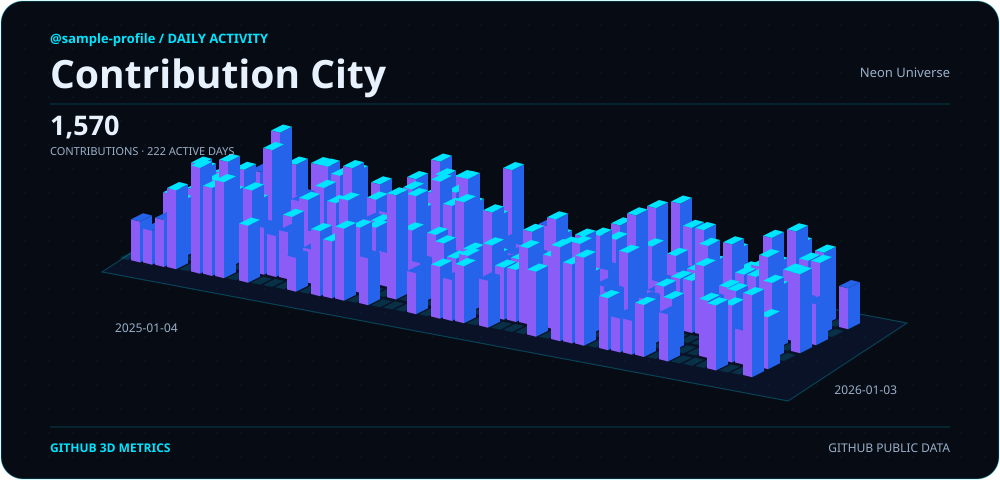

# GitHub 3D Metrics

**Your Code. Your Universe.**  
Created by **0xAllow** · MIT

Turn your public GitHub contribution calendar into an isometric skyline. Generate static SVG cards in your own repository, customize them on GitHub Pages, or render them locally through the MCP server.



## Install in your profile README

1. Create a **public** repository under your user account. Give it the same name as your GitHub username and initialize it with a README.
2. Copy [the example workflow](examples/update-now.yml) into `.github/workflows/update-now.yml` in your profile repository. Replace `YOUR-GITHUB-USERNAME` with your own login. The workflow expects the upstream project to be publicly available at `0xAllow/github-3d-metrics`.
3. Open your repository’s **Actions → Update Now → Run workflow** and select the default branch. If Actions asks you to enable workflows, enable this one.
4. Check the run summary. After a successful run, add the following line to your README.

```markdown

```

Use **Update Now** again whenever you want to refresh. The workflow commits changed assets. A fetch or rendering failure leaves the previous committed image in place. A successful run can take several minutes, and updates may take longer to appear in GitHub’s image cache.

For dashboard-based setup, open [the project’s expected Pages URL](https://0xallow.github.io/github-3d-metrics/) after the maintainer deploys it, enter your username, then copy the workflow and README embed from **Setup**. The studio uses sample data on first visit. After your first successful run, **Load snapshot** reads the generated public JSON from your profile repository’s default branch.

## Visualizations

| View | GitHub data and encoding |
| --- | --- |
| Contribution City | One building per day in the trailing 365 UTC-date window. Height uses the square root of the day’s count, scaled to the largest day in the window. |
| GitHub Stats | Current follower count and the count, sum of stars, and sum of forks of owned public repositories, including repositories forked by the user. |
| Language Distribution | [GitHub Languages API](https://docs.github.com/en/rest/repos/repos#list-repository-languages) bytes summed across owned, public, non-fork repositories. The top six languages are listed individually. |
| Repository Constellation | Up to twelve owned public repositories ranked by stars. Node radius increases logarithmically with star count. Node positions are for layout. |
| Activity Timeline | Weekly sums from the same calendar. The first and last week may be partial. |
| Combined Statistics | Profile metrics and Contribution City in one image. |

The seven free palettes are [shown in the theme gallery](docs/themes.md). Configure the view, theme, sizes, colors, geometry style, metrics, and optional date label using the [configuration example](examples/config.json). The date label is the UTC date when the snapshot contents last changed. GitHub’s own contribution rules determine calendar counts. The application declines calendars with reported restricted contributions.

## Run locally

Use Node.js 24 LTS and npm.

```sh
npm install
npm run dev
npm run generate -- --username octocat --options '{"view":"stats"}'
```

Set `GITHUB_TOKEN` in your environment for GraphQL calendar views. See [token guidance](docs/mcp.md#github-access) and [troubleshooting](docs/troubleshooting.md). Use `--root PATH` to generate under another local repository, and `--light-pair` to add a separate light SVG. The CLI never commits or pushes. See [MCP setup](docs/mcp.md), [architecture](docs/architecture.md), and [Pages deployment](docs/pages.md).

```sh
npm run test:core
npm run build
npm test
npx playwright install chromium
npm run e2e
npm audit --audit-level=high
```

See [verification status](docs/verification.md), [contribution guidance](CONTRIBUTING.md), and the [security reporting process](SECURITY.md).
