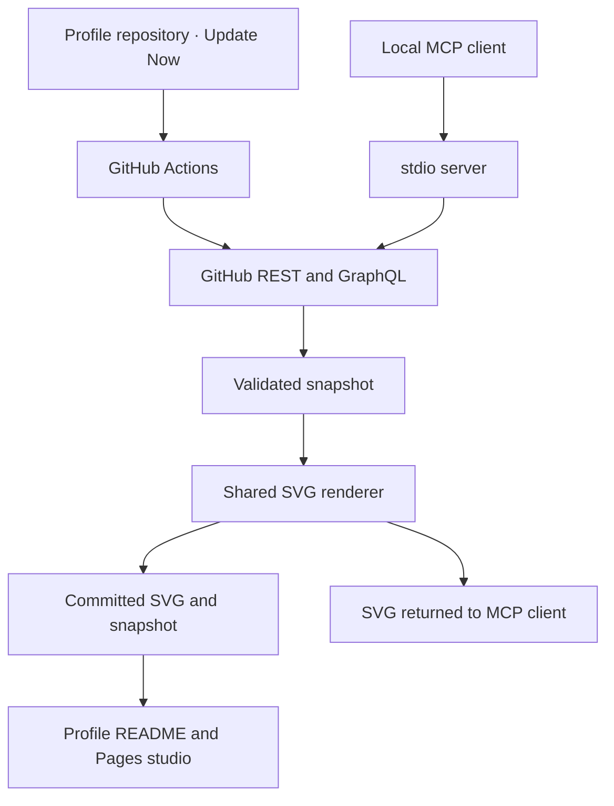

# Architecture

`src/model.ts` validates the versioned data and configuration. `src/github.ts` reads a fixed GitHub API origin, uses GraphQL variables, bounds responses and individual request duration, and reports rate limits. Repository lists are paginated. The language view reads the language endpoint in batches of four and stops with a clear error above 250 original repositories. Other views skip those requests. Calendar queries use an authenticated trailing 365 UTC-date window and fail if it is incomplete or GitHub reports restricted contributions.

`src/render.ts` builds deterministic, self-contained SVGs from normalized data. SVGs have a fixed internal design grid and configurable outside dimensions. Different aspect ratios can add padding. Transparent uses a color scheme media query. The optional second SVG and the README’s picture element provide GitHub-specific light/dark selection.

`src/cli.ts` renders and validates assets before writing. It stages changes in temporary files and uses atomic per-file replacement. The workflow makes one commit for the generated set and pushes without force. GitHub serializes updates to a given branch. If that branch advances during an update, the push fails and a subsequent run starts from the new branch tip.

The dashboard is a static React/Vite build. Its initial SVG preview has no GitHub network dependency. It loads the WebGL bundle on demand and can read the generated snapshot using GitHub’s unauthenticated REST API. The dashboard holds no token and links to GitHub’s workflow page for authorization. MCP shares the data and renderer modules, returning SVG text over stdio.
